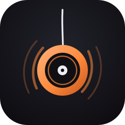

# Throw



An unresponsive (1A) yo-yo trick guide and trainer for Urbit.

```
|install ~nosfyl %throw
```

## What's in it

- **Path**: 50 tricks in four levels: Foundations, Unresponsive core, Advanced and Expert. Each trick has prerequisites, steps, tips, common mistakes and links to video tutorials. Tricks unlock as you land their prerequisites, and "Up next" picks what to learn.
- **Train**: rep drills. Tap **Land** or **Miss** after each try (or press Space/L, X/M, N for next, U to undo). The page tracks your streak toward each trick's goal: land it N in a row and the trick is marked *solid*. You get a nudge after 15 misses in a row and a break reminder at 25 minutes. Tricks landed more than a week ago come back for review.
- **Ladder**: a run of the yoyotricks.com 1A Sport Ladder (25 tricks, one attempt each, two misses ends the run). Your best scores are saved.
- **Guide**: troubleshooting for tilt, binds, snags, knots, hops and slack. It also covers setup, string tension, how to bind, string and bearing care, how to practice, and a glossary.
- **Log**: practice time, land rate, day streak, a 20-week heatmap and per-trick totals. It also tracks minutes on your current string, since string should be changed every 30–120 minutes of play.

Data lives in the `%throw` agent on your ship (owner-only JSON API under `/apps/throw/api`).

## Sources

The trick content was collected from [yoyotricks.com](https://yoyotricks.com/yoyo-tricks/) (the unresponsive and 1A lists, the Sport Ladder and trick pages), [YoYoExpert](https://yoyoexpert.com/pages/learn-yoyo-tricks) and its forums, and [Skill Addicts](https://skilladdicts.com/best-yoyo-tricks/). The steps are outlines. Watch the linked tutorial for each trick.

## From source

```
|new-desk %throw
|mount %throw
```
Then copy `desk/` into the mounted `throw` folder and run:
```
|commit %throw
|install our %throw
```
